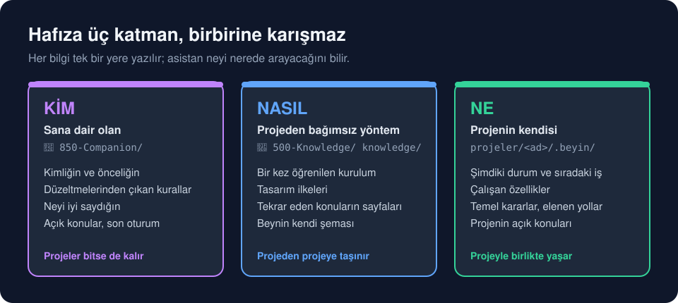
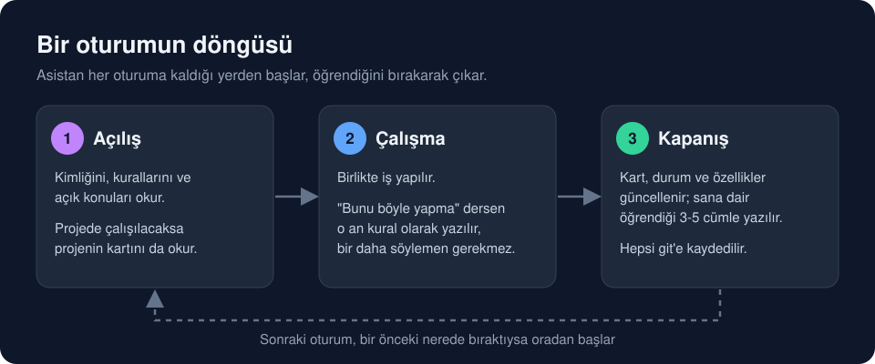
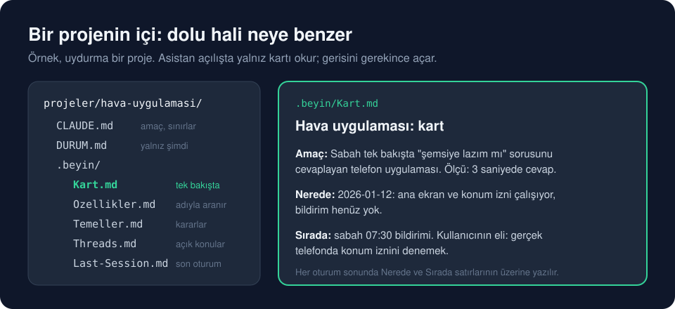

# İkinci Beyin

**Yapay zeka asistanın her yeni sohbette seni sıfırdan tanımasın.** İkinci Beyin, terminalde çalışan bir
yapay zeka asistanıyla (Claude Code, Codex CLI, Gemini CLI, OpenCode) kullanılan bir hafıza klasörüdür: kim
olduğunu, seni nasıl düzelttiğini, projelerinin nerede kaldığını düz Markdown dosyalarında tutar. Asistan her
oturuma bu dosyaları okuyarak başlar, öğrendiğini yerine yazarak bitirir.

Bu depo o klasörün düzenini, kurallarını ve şablonlarını taşır. İçi boş gelir; sen kullandıkça dolar.

Terminal asistanı · Markdown · Git · isteğe bağlı Obsidian · MIT lisansı

---

## Neyi çözer

Bir yapay zeka asistanıyla uzun süre çalışınca aynı üç sorun çıkar:

| Sorun | İkinci Beyin'de |
| --- | --- |
| Her yeni sohbette projeyi baştan anlatırsın | Asistan projenin kartını okur, kaldığı yerden başlar |
| Bir kez düzelttiğin hatayı ertesi gün yine yapar | Her düzeltme o an kurala dönüşür ve her açılışta okunur |
| Notlar biriktikçe çöplüğe döner, önemli olan kaybolur | Dosyalar yalnız bugün geçerli olanı söyler; geçmiş git'te durur |

## Nasıl çalışır



Hafıza üç katmandır ve birbirine karışmaz. **Kim** sana dair olandır: kuralların, ölçün, açık konuların. Projeler
bitse de kalır. **Nasıl** bir projede öğrenilip başka projede de işe yarayan yöntemdir. **Ne** projenin kendisidir
ve projeyle birlikte yaşar. Her bilgi tek bir yere yazıldığı için asistan neyi nerede arayacağını bilir, aynı bilgi
iki yerde çelişmez.



Döngünün kuralları kökteki [`AGENTS.md`](AGENTS.md) dosyasında yazar. Bu, terminal asistanlarının ortak kural
dosyası adıdır: asistan onu her oturumun başında kendiliğinden okur, bu yüzden ek bir program kurmak gerekmez.

---

## Kurulum

### Gerekenler

| Ne | Neden | Nereden |
| --- | --- | --- |
| Terminal asistanı | Klasörü okuyup yazan yapay zeka; çoğu bir abonelik ya da API anahtarı ve ilk açılışta giriş ister | Aşağıdaki tablodan birini seç |
| Git | Geçmişi tutar, bilgisayarlar arasında taşır | [git-scm.com](https://git-scm.com/downloads) |
| GitHub hesabı | Yedek ve ikinci bilgisayar için; zorunlu değil | [github.com](https://github.com) |
| Obsidian | Notları görsel olarak gezmek için; zorunlu değil | [obsidian.md](https://obsidian.md) |

Asistan olarak şunlardan birini kullanabilirsin. Hepsi aynı `AGENTS.md` dosyasını okur; okuma yolu farklı olanlar
için gereken küçük ayar dosyası depoyla hazır gelir, senin bir şey yapman gerekmez.

| Asistan | Kural dosyasını nasıl okur | Komut | Nereden |
| --- | --- | --- | --- |
| Claude Code | Kökteki `CLAUDE.md` onu `AGENTS.md` dosyasına yönlendirir | `claude` | [claude.com/claude-code](https://claude.com/claude-code) |
| Codex CLI | `AGENTS.md` dosyasını doğrudan okur | `codex` | [github.com/openai/codex](https://github.com/openai/codex) |
| Gemini CLI | Hazır gelen `.gemini/settings.json` ile `AGENTS.md` dosyasını okur | `gemini` | [github.com/google-gemini/gemini-cli](https://github.com/google-gemini/gemini-cli) |
| OpenCode | `AGENTS.md` dosyasını doğrudan okur | `opencode` | [opencode.ai](https://opencode.ai) |

Kurulu olduklarını uçbirimde şöyle denetleyebilirsin; ikisi de bir sürüm numarası yazmalı. İkinci satırdaki
`codex` yerine kendi asistanının komutunu yaz.

```bash
git --version
codex --version
```

Git'i yeni kurduysan bir kez adını ve e-postanı tanıt; yoksa ilk kayıtta hata alırsın. Üçüncü satır, klasör
adlarındaki simgelerin git çıktısında okunur görünmesini sağlar:

```bash
git config --global user.name "Adın Soyadın"
git config --global user.email "e-posta@adresin.com"
git config --global core.quotepath false
```

### 1. Kendi kopyanı oluştur

**GitHub ile (önerilen).** Bu sayfanın üstündeki **Use this template** düğmesine bas, **Create a new repository**
seç. Depoya bir ad ver ve **Private** işaretle: beynin zamanla kişisel bilgi taşıyacak ve asistan her oturum
sonunda onu gönderecek. **Fork düğmesini kullanma:** herkese açık bir deponun çatalı (fork) özel yapılamaz, içine
yazdığın her şey herkese açılır. Sonra bilgisayarına indir:

```bash
git clone https://github.com/KULLANICI-ADIN/DEPO-ADIN.git ikinci-beyin
cd ikinci-beyin
```

**GitHub'sız.** Sayfanın üstündeki **Code** düğmesinden **Download ZIP** ile indir ve istediğin yere aç. Açılan
klasörün adı depo adının sonuna `-main` eklenmiş halidir; adını `ikinci-beyin` yap ve içinde git'i başlat:

```bash
cd ikinci-beyin
git init
git add -A
git commit -m "ikinci beyin kuruldu"
```

### 2. Klasörü asistanınla aç

Uçbirimde klasörün içindeyken asistanının komutunu yaz (`claude`, `codex`, `gemini` ya da `opencode`). Önemli
olan, oturumun bu klasörün **kökünden** açılması: `AGENTS.md` orada durur.

### 3. Asistanla tanış

İlk oturumda şunu yaz:

> AGENTS.md dosyasını oku. Beni tanımak için birkaç kısa soru sor ve cevaplarımla Core.md ile Olcu.md
> dosyalarını doldur. Bitince oturumu kapanış kurallarına göre kaydet.

Asistan sana kim olduğunu, ne üzerinde çalıştığını ve nasıl bir dil istediğini sorar, cevaplarını
`🔮 850-Companion/` altına yazar.

### 4. Çalıştığını doğrula

Bu adım, kurulumun gerçekten işlediğini görmenin tek yolu:

1. Asistanı bir konuda düzelt: *"Bundan sonra cevaplarında madde listesi kullanma, düz paragraf yaz."* Asistan
   bunu beklemeden `🔮 850-Companion/Kurallar.md` dosyasına yazar ve sana söyler.
2. *"Oturumu kaydet"* de, sonra oturumu kapat ve **yeni bir oturum** aç.
3. Sor: *"Benimle ilgili hangi kuralları biliyorsun?"*

Asistan söylediğin kuralı geri okuyorsa beyin çalışıyor. Kuralın dosyaya girdiğini kendi gözünle de görebilirsin:

```bash
git log --oneline -3 -- "🔮 850-Companion/Kurallar.md"
```

Listede en az bir kayıt görünmeli; dosyayı açınca kural en altta durur.

### 5. İlk projeni aç

> Şablondan `hava-uygulamasi` adında yeni bir proje aç. Amacı ve bittiğinin ölçüsünü bana sor.

Asistan `📋 Templates/Proje/` klasörünü `projeler/hava-uygulamasi/` altına kopyalar, `{{AD}}`, `{{AMAC}}` gibi
yer tutucuları sana sorarak doldurur. O projede çalışırken her açılışta önce projenin kartını okur.

### 6. Yedekle (GitHub kullanıyorsan)

Asistan her oturumun sonunda değişiklikleri git'e kaydeder ve uzak depoya gönderir. Elle yapmak istersen:

```bash
git add -A
git commit -m "oturum notları"
git push
```

### İsteğe bağlı: ikinci bilgisayar ve Obsidian

**İkinci bilgisayar.** Aynı depoyu orada da `git clone` ile indir. Asistan her oturumun başında son hali çeker,
sonunda gönderir; iki bilgisayar aynı beyni paylaşır. Yalnız o bilgisayara ait işler için kökte `yerel/` adında
bir klasör aç; o klasör git'e hiç girmez, bu yüzden kopyada hazır gelmez.

**Obsidian.** Obsidian'da **Open folder as vault** ile `ikinci-beyin` klasörünü seç. Notlar arasındaki
bağlantıları harita olarak görürsün. Obsidian nokta ile başlayan klasörleri (`.beyin/`) göstermez; proje hafızasına
dosya gezgininden ya da asistandan bakılır.

### Sorun çıkarsa

| Belirti | Neden ve çözüm |
| --- | --- |
| Asistan seni tanımıyor gibi davranıyor | Oturum kökten açılmamıştır. Klasörün kökünden yeniden aç ya da *"AGENTS.md dosyasını oku"* de |
| Kurallar dosyası hiç değişmiyor | Kapanış adımı atlanmıştır. Oturum sonunda *"oturumu kapanış kurallarına göre kaydet"* de |
| İki bilgisayarda farklı notlar var | Bir taraf göndermeden kapanmıştır. Önce `git pull`, sonra çalışmaya başla |
| Emoji içeren klasör adları uçbirimde garip görünüyor | Yalnız görünüştür; dosyalar doğru çalışır. Tırnak içinde yaz: `cd "🔮 850-Companion"` |

---

## Klasörler

```
AGENTS.md               Asistanın her oturumda okuduğu ana kurallar
CLAUDE.md, .gemini/     Claude Code ile Gemini CLI'ı AGENTS.md dosyasına yönlendiren küçük dosyalar
🔮 850-Companion/       Kim: kimlik, kurallar, ölçü, sözlük, açık konular, son oturum
🧠 500-Knowledge/       Nasıl: kalıcı yöntem; genel şema beyin-haritasi.md
knowledge/              Raf: tekrar eden konuların sayfaları ve fihristi
daily/                  Günlük oturum özetleri
projeler/               Projelerin; her biri hafızasını kendi .beyin/ klasöründe taşır
📋 Templates/           Not ve proje şablonları
📥 000-Inbox/           Hızlı yakalama
📦 900-Archive/         Güncelliğini yitirmiş ama atılmayan notlar
yerel/                  Yalnız bu bilgisayara ait işler (git dışı; gerekince sen açarsın)
```

Dosya dosya ayrıntı: [beyin-haritasi.md](🧠%20500-Knowledge/beyin-haritasi.md).

## Bir projenin içi



Asistan açılışta projenin yalnız kartını ve kısa durum dosyasını okur; kart beş satırdır, bağlamı küçük tutar. Çalışan özellikler
`Ozellikler.md` içinde her biri kendi başlığında durur ve adıyla aranır, baştan sona okunmaz. Geçerli kararlar ve
**elenen yollar** `Temeller.md` içindedir: denenip bırakılan fikir yazılı olduğu için aylar sonra yeniden
denenmez.

---

## Tasarım kararları

Bu düzen [AvenoxBeyin](https://github.com/avenoxai/avenoxbeyin) projesinin ikinci sürümünden yola çıktı ve
yaklaşık üç ay boyunca, neredeyse her gün kullanılarak değişti. Değişenlerin her biri yaşanmış bir sorundan geldi:

| Karar | Neden |
| --- | --- |
| Bitmiş işin hikayesi dosyalarda tutulmaz | Notlar "ne yaptık" günlüğüne dönünce asistan bugünü bulmak için geçmişi okumak zorunda kaldı. Dosyalar yalnız şimdiyi söyler; geçmiş git'te durur |
| Kural, kapsamına göre yazılır | Genel kural defteri bir ayda üç katından fazla büyüdü ve yarısı tek projeye ait çıktı. Artık her projede geçerli olan genel deftere, projeye özgü olan projeye yazılır |
| Proje hafızası proje klasöründe | Projeler gelir geçer; projeyle ilgili not proje silinince birlikte gider, beyni kirletmez |
| Elenen yollar da yazılır | Aynı tutmayan fikir haftalar sonra yeniden önerildi. Yazılı ret bunu durdurur |
| Sözlük dosyası | Asistanın kendi uydurduğu teknik adlar kullanıcıya bir şey ifade etmiyordu. Söylenmeyecek sözler ve karşılıkları tek yerde |
| Silmek ile arşive indirmek ayrı | İşe yaramayan not silinir; bir zaman doğru olmuş ama eskiyen not arşive iner. İkisi karışınca ya çöp birikiyor ya bilgi kayboluyordu |

## Kendi beynimde

Bu depo, benim her gün kullandığım beynin içi boşaltılmış halidir. Benim kopyamda düzenin üstünde onu kendiliğinden
işleten betikler de var; burada yer almıyorlar, ama düzenin ne kadar taşıdığını gösteriyorlar:

| Ölçü | Değer |
| --- | --- |
| Kullanım süresi | Ağustos 2026'dan bu yana, 83 günün 64'ünde |
| Git'e kaydedilen oturum ve değişiklik | 1.270'in üzerinde |
| Aynı anda yürüyen proje | 17 |
| Düzeltmelerden çıkan genel kural | 56 |
| Raftaki konu sayfası | 200'ün üzerinde |
| Toplam hafıza / açılışta okunan | 407 KB / 15,5 KB (beynin günlük karnesinden) |

Son satır düzenin asıl getirisi: hafıza büyüdükçe asistanın her açılışta okuduğu kısım küçük kalıyor, çünkü her şey
tek yerde ve gerekince okunuyor. Benim kopyamdaki ek parçalar şunlar: geceleri günlükleri konu sayfalarına işleyen
ve eskiyen notu arşive indiren bir döngü, konusu geçince ilgili notu hatırlatan bir kanca ve asistanın kendi özetini
geçmiş düzeltmelerden oluşan bir sınavla denetleyen bir kontrol.

---

## Sık sorulanlar

**Notlarım nerede duruyor?** Yalnız senin bilgisayarında ve kendi git deponda, düz Markdown dosyaları olarak.
Asistan çalışırken okuduğu dosyalar kullandığın yapay zeka hizmetine gönderilir; bu, bulutta çalışan her asistanın
olağan hali. Yerel bir modelle çalışan bir asistan seçersen dosyalar bilgisayarından çıkmaz.

**Hangi asistanla çalışır?** Düzen düz dosyalardan oluştuğu için `AGENTS.md` dosyasını okuyan ve dosya yazıp git
komutu çalıştırabilen her terminal asistanıyla. Ben her gün Claude Code ile kullanıyorum; yukarıdaki tablodaki
öbür asistanlar da aynı dosyayı okur.

**Ek ücret ya da sürekli açık bir hizmet var mı?** Yok. Seçtiğin asistanın kendi ücreti dışında hiçbir şey gerekmez.

**Her şeyi kendiliğinden hatırlar mı?** Hayır. Asistan yalnız dosyalara yazılanı hatırlar. Kapanış adımı bu yüzden
önemli: kaydedilmemiş bir oturum hiç yaşanmamış sayılır.

## Güvenlik

Beyne parola, erişim anahtarı, kimlik ya da kart numarası yazma: asistan her oturum sonunda dosyaları git'e
kaydeder ve uzak depoya gönderir. Böyle bir bilgiyi tutman gerekiyorsa git dışında kalan `yerel/` klasörüne koy.
Şablondan açtığın depo bu depoya bağlı kalmaz; buradaki sonraki değişiklikler sana kendiliğinden gelmez. `AGENTS.md`
asistana verilen talimattır: dışarıdan aldığın bir değişikliği ya da katkıyı eklemeden önce oku.

## Lisans ve teşekkür

MIT lisansı, ayrıntısı [LICENSE](LICENSE) dosyasında. Bu çalışmanın temeli olan
[AvenoxBeyin](https://github.com/avenoxai/avenoxbeyin) projesini yayımlayan [Avenox](https://github.com/avenoxai)'a
teşekkürler: klasör düzeni ve Companion fikri oradan gelir.
